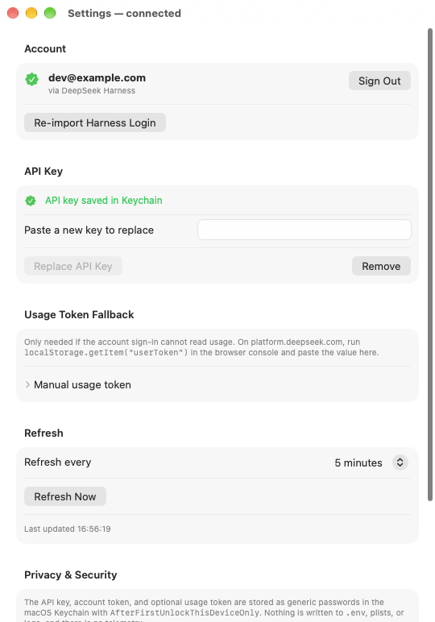

# DeepSeek Usage Tracker

A native macOS menu bar tracker for **DeepSeek balance** and **today's usage**: two compact numbers in the menu bar, a detailed menu, and a small settings window.

Maintained by [okric](https://github.com/okric).




## What it shows

- **Available balance** — the primary wallet plus any other positive currency balances (for example a CNY bonus on a USD account).
- **Today** — spend in the currency that was actually charged today, plus tokens, request count, and cache-hit rate.
- **Last 30 days** — token total, with a 7-day token/request breakdown. Token counts are currency-neutral; spend is intentionally shown only for *today* because an account can have cost buckets in more than one currency.
- **Low-balance and session states** — green/normal, orange/low, red/unavailable or rejected credential, with the last good values kept and marked stale.
- Refresh every 1, 5, 15, or 30 minutes; wake-from-sleep refresh; manual refresh.

## First run

1. Build and launch the app. It lives in the menu bar (no Dock icon).
2. Click the menu bar item:
   - **Use DeepSeek Harness Login** — reads `~/.dsh/.credentials.yaml` **once**, copies the DeepSeek account token into this app's Keychain, and imports the Harness API key if no API key is saved yet. This reuses the login you already have in DeepSeek Harness.
   - **Sign in with DeepSeek…** — opens the browser and completes DeepSeek's PKCE authorization flow through a one-time `127.0.0.1` callback.
   - **Enter API Key…** — paste a DeepSeek API key (starts with `sk-`). This is optional; it enables the official `api.deepseek.com/user/balance` endpoint.
3. Optional fallback: if a browser/Harness login cannot read usage, paste the Platform `userToken` under **Settings → Usage Token Fallback**.

The Harness import is explicit: the app checks that the file exists, but only reads it when you click the import button. It never watches or modifies the Harness file.

## How the data is obtained

| Data | Endpoint | Credential |
|---|---|---|
| Official balance | `GET https://api.deepseek.com/user/balance` | API key (`Bearer`) |
| Platform balance | `GET https://platform.deepseek.com/api/v0/users/get_user_summary` | account token (`x-dsh-auth-token`) |
| Today / daily usage | `GET .../api/v0/usage/by_api_key/amount?start=&end=&tz=` and `.../cost` | account token |
| Monthly fallback | `GET .../api/v0/usage/amount?month=&year=` and `.../cost` | account token |

DeepSeek does not document a public usage API. The usage endpoints are the private dashboard endpoints; the browser sign-in uses the same PKCE flow as DeepSeek Harness (`/auth-api/v0/dsh/auth_init` → `/dsh/authorize` → `/auth-api/v0/dsh/auth_exchange`). They can change or rate-limit without notice. The official balance endpoint and the API-key/manual-token fallbacks keep the app useful if they do.

**Currency detail:** DeepSeek can return cost data in more than one currency. For example, a USD wallet may hold older spend while today's usage is charged against a CNY bonus. The parser therefore chooses the cost block with spend *today* for the “Today” number, rather than blindly preferring USD. The 30-day row shows only tokens to avoid presenting an invalid cross-currency total.

## Security

- API keys, the account token, and the optional usage token are stored as **generic passwords in the macOS Keychain** with `kSecAttrAccessibleAfterFirstUnlockThisDeviceOnly`.
- No `.env`, plist, UserDefaults, or logs contain secrets. There is no telemetry.
- The Harness importer reads only `~/.dsh/.credentials.yaml` and only on explicit user action. It copies the token (and API key, if present) into this app's Keychain; it does not watch, upload, or modify the file.
- Authenticated requests disable redirects; browser URLs are validated against `https://platform.deepseek.com/dsh/authorize` and `/dsh/authorized`; the OAuth callback validates `state` and the loopback path.
- The app is ad-hoc signed for local use. Rebuilding changes the ad-hoc code signature, so macOS may ask for Keychain access again — choose **Always Allow**. For distribution, sign and notarize with your own Developer ID.

## Build and test

Requirements: macOS 14+, Xcode, and [XcodeGen](https://github.com/yonaskolb/XcodeGen).

```bash
xcodegen generate
xcodebuild -project DeepseekUsageTracker.xcodeproj \
  -scheme DeepseekUsageTracker -configuration Debug \
  -derivedDataPath build build

xcodebuild -project DeepseekUsageTracker.xcodeproj \
  -scheme DeepseekUsageTracker -configuration Debug \
  -derivedDataPath build -destination 'platform=macOS' test
```

`project.yml` is the source of truth; run `xcodegen generate` after adding or removing files. The 15 tests cover balance/usage parsing, multi-currency cost selection, date windows, PKCE/URL validation, the loopback callback server, the Harness YAML parser, and the Keychain round-trip.

Release build:

```bash
xcodebuild -project DeepseekUsageTracker.xcodeproj \
  -scheme DeepseekUsageTracker -configuration Release \
  -derivedDataPath build build
```

## Layout

```
Sources/
  App/        App entry point, AppModel, menu bar controller
  Core/       API client, models, PKCE/browser auth, Keychain, Harness importer
  UI/         Status item drawing, settings window (SwiftUI)
Tests/        Parser, date, auth, callback, Keychain tests
project.yml   XcodeGen project definition
docs/         README screenshots (sample values, not account data)
```

## Notes

- The app is independent and not affiliated with DeepSeek.
- The Harness token is tied to the account session; if it is revoked, re-import or sign in again.
- The “Use DeepSeek Harness Login” path requires DeepSeek Harness to be installed and signed in on the same machine.

## References

- [DeepSeek API — Get User Balance](https://api-docs.deepseek.com/api/get-user-balance/)
- [CodexBar DeepSeek provider notes](https://github.com/steipete/codexbar/blob/main/docs/deepseek.md)
- [dsh-deepseek-usage](https://github.com/AzureHalcyon/dsh-deepseek-usage)
- [DeepSeek Harness account-platform package](https://github.com/deepseek-ai/deepseek-harness/blob/master/packages/credentials/deepseek-account-platform/README.md)

Project author: [okric](https://github.com/okric)

> **Vibe coding note:** The code in this project was "vibe coded" with [DeepSeek Harness](https://github.com/deepseek-ai/deepseek-harness) and **DeepSeek V4.1 Flash**.
